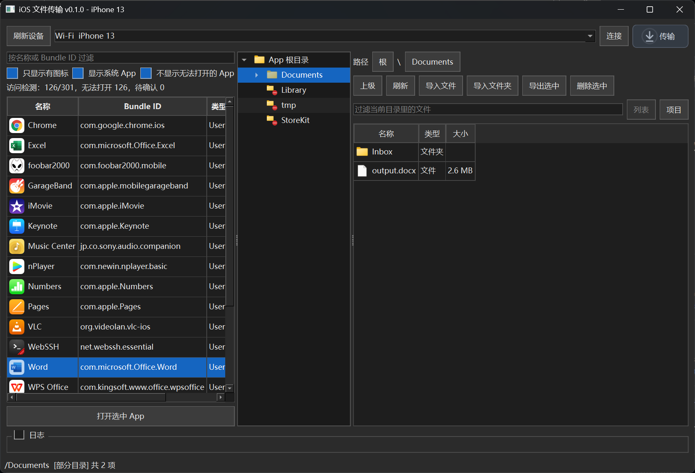

# iOS 文件传输工具

**由 Grok 4.7 和 Gpt-6.1 Sol 制作。**

在 Windows 与 iPhone App 之间传输文件，支持 USB / Wi-Fi、拖放和剪贴板复制。



## 运行环境

- Windows，Python 3.14（64 位；已在 Python 3.14.7 验证）。
- 安装 Apple 设备或 iTunes，提供 Apple Mobile Device 驱动。首次连接需在手机上信任电脑。

## 依赖库

- `PySide6`：图形界面。
- `pymobiledevice3`：连接 iPhone、访问 App 文件。
- `pywin32`：Windows 拖放和剪贴板支持。

在项目目录安装依赖并启动：

```powershell
python -m pip install -r requirements.txt
python IosFileTool.py
```
